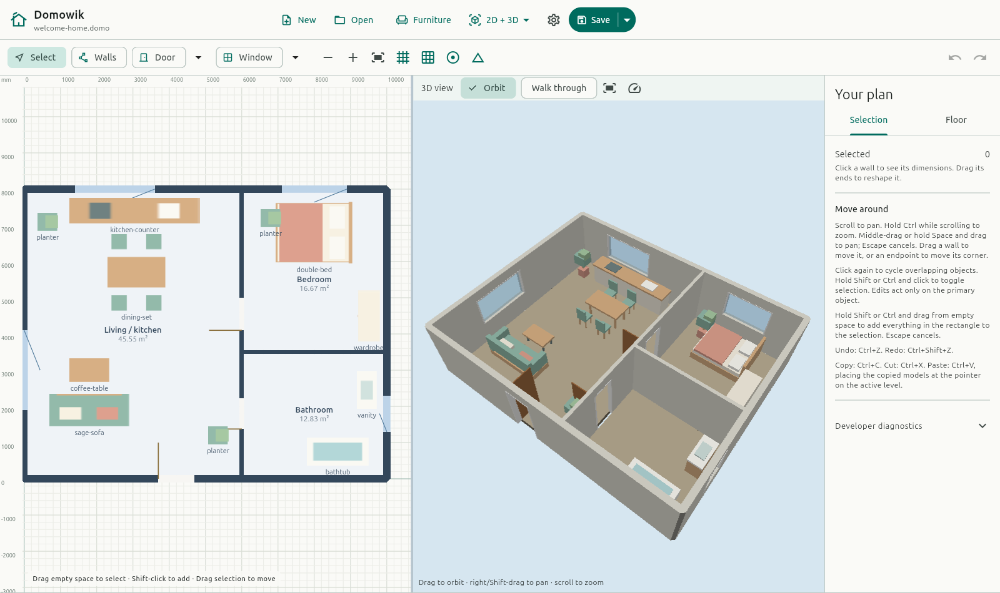
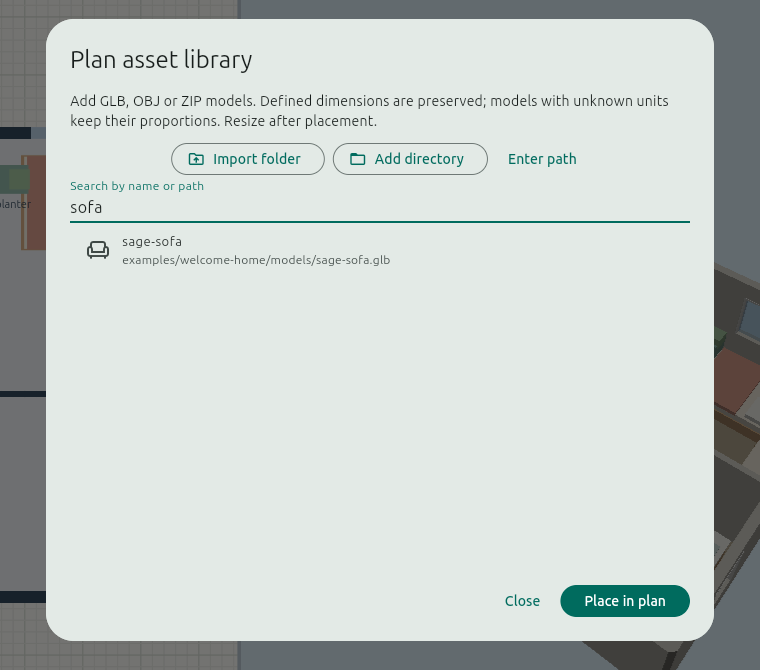

# Editor user guide

This guide describes the experimental editor, not a finished product. Follow
[Getting started](GETTING-STARTED.md) to run it. Keep backups of important
plans and read [compatibility and limitations](COMPATIBILITY.md).

## Explore a furnished example

[Welcome Home](../examples/welcome-home/README.md) is a ready-to-open imaginary
home with an open living/kitchen area, bedroom, bathroom and original mock
furniture. Download its `.domo` file, choose **Open**, then **2D + 3D**. Models
are embedded, so it works without a local asset library. Save a copy before
experimenting with furniture placement, doors and wall edits.

The left canvas is the editable plan; the right pane shows the same document
in 3D. Room areas are derived from the walls. **Furniture** opens the embedded
model library; selecting a placed object exposes its size and placement.

## Your first plan

1. The editor starts with an untitled plan. Choose **Walls**, then drag on
   empty canvas to draw a wall. Draw a closed outline to obtain a derived room.
2. Select a wall or an endpoint to move it. The inspector exposes wall
   thickness, height and centreline length editing.
3. Choose **Door** or **Window**, then click a host wall. Select an opening to
   edit its position, size and mechanism. Its handles support movement,
   resizing and rehosting; door controls depend on the selected mechanism.
4. Use the level controls to switch the active level and adjust its properties.
   Visible and ghosted non-active levels provide context; edits target the
   active level.
5. Save a `.domo` plan. The CLI can read, validate and export the same file.

The header's labelled buttons create (**New**) and open (**Open**) plans,
open the **Furniture** library and switch between **2D**, **3D** and
**2D + 3D**; the gear opens preferences, and the split save control ends
the row: press most of it to save the plan, or press its chevron section
for **Save as**. In narrow windows the labelled buttons shrink to icons
with tooltips. The sidebar opens on **Selection**, with object properties
and 3D placement directly below **Your plan**. **Floor** holds level controls,
room information and floor totals. Selecting an object brings **Selection**
forward. The tabs scroll independently; switching tabs preserves live placement
drafts. Below 900 pixels of width it becomes a drawer: use the layers
button (**Levels and plan details**). Status messages appear below the
canvas; hover for the full message or use **Copy status message**.
Each layer's **Edit options** opens its properties; the active floor's menu also
contains **Delete floor**. Only an empty, unreferenced floor can be deleted, and
the last floor cannot be removed. Drag the handle beside a floor's name to
reorder the list itself: the panel keeps the order you store, even when it
differs from the floors' elevations. Reordering only changes the list — paint
tiers, the 3D view, warnings and every elevation-based behaviour keep using
the floors' elevations. The CLI's `domowik order-levels PLAN "Upper" "Lower"`
(from the top of the list first) stores the same order and is preserved when
the editor reopens the plan.

On first open, the first floor at the top of the list is active. Choose a
floor in **Floor** to make it active. Reopening restores your last choice on
this device, without needing to save the plan; if that floor no longer exists,
the first listed floor is selected. Older plans are remembered too, by file
location on desktop, or file name and floor IDs in a browser. Moving or renaming
an older desktop file resets its memory; **Save as** keeps the current floor
for the new location. Everything else about the view resets on open:
visibility tiers, camera fit, grid and rulers all return to their defaults.
Warnings are separate from operation errors; use their item controls to locate
the affected objects. A warning is not automatically a rejected edit.

Room geometry and floor areas are derived from walls. Areas use the inner wall
faces rather than centreline rectangles. Room naming uses a record with a seed
point, not a separately editable room polygon. See the
[CLI room example](../README.md#try-it) and the behavior specification for
association rules when a room is split or opened to the exterior.

## Navigate and select in 2D

The editor's in-app hints detect the platform. Use these primary shortcuts:

| Action | Linux | macOS |
| --- | --- | --- |
| Pan | Scroll, middle-drag, or Space-drag | Scroll, middle-drag, or Space-drag |
| Zoom about the cursor | Ctrl + scroll | Command (⌘) + scroll |
| Toggle an object in the selection | Shift-click or Ctrl-click | Shift-click or Command-click |
| Select with a marquee | Drag from empty canvas in Select | Drag from empty canvas in Select |
| Add to selection with a marquee | Shift-drag or Ctrl-drag from empty canvas | Shift-drag or Command-drag from empty canvas |
| Copy selected furniture | Ctrl+C | Command+C |
| Cut selected furniture | Ctrl+X | Command+X |
| Paste furniture at the pointer | Ctrl+V | Command+V |
| Rotate selected furniture | R | R |
| Undo | Ctrl+Z | Command+Z |
| Redo | Ctrl+Shift+Z | Command+Shift+Z |
| Cancel a gesture | Escape | Escape |

**Select** is the default tool and never draws walls; choose **Walls** to draw.
Click repeatedly at the same spot to cycle overlapping objects. Drag any
selected member to move selected walls and furniture together, with one Undo
to restore the group. A walls-only selection supports bulk height/thickness
editing (below); other inspector edits and Delete act on the **primary object**.
Removing the primary does not silently promote another object.
The marquee selects intersecting active-level walls, resolved furniture
footprint envelopes and degraded asset instances together; a rectangle over several
objects selects them all. Degraded placeholders cannot move as a group. An
opening can accompany its selected host wall; select its host too, or move the
opening individually.

Furniture uses the axis-aligned envelope of its displayed footprint for marquee
selection, so a rotated object's envelope can be selected without touching its
exact silhouette. Shift-click also toggles individual objects in the group.

Drag a wall body to move it, or an endpoint to move its joined corner. Escape
during a gesture restores the pre-gesture state; Escape while idle clears the
selection. Escape also cancels a pan.

**Fit plan** explicitly frames the plan. Editing does not automatically refit
the camera. The **+ / −** controls zoom; arrow keys pan by a grid step rather
than nudging selected objects. Grid display and snapping are separate controls.
Plan +Y points upward. **Preferences → Measurement units** selects **Metric**
(millimetres, square metres) or **Imperial** (decimal inches, square feet;
rulers in feet). Save applies the choice to all plans on this device and
remembers it across restarts. Cancel discards changes. Angles stay in degrees;
switching units does not change stored geometry, grid/snapping or undo history.

## Change several walls' height or thickness

1. In **Select**, Shift-click walls to add them, or drag a selection rectangle.
   Select only walls on the active floor, not furniture or openings.
2. In **Selection**, choose **Edit height and thickness**.
3. Enter the desired height and/or thickness, then **Apply**. A field shows
   **Mixed** when the selected walls differ. Leave a field blank to preserve
   each wall's existing value for that property.

The change applies to all selected walls in one undo step. Lengths, endpoints,
unselected walls and floor defaults stay unchanged. Invalid changes, including
making a wall too short or thin for a hosted door/window, are rejected as a whole.
**Cancel** or Escape discards the form without editing the plan.

## In a web browser

The browser editor ([getting started](GETTING-STARTED.md#run-the-browser-editor))
is the same editor on the same core. On the tested Intel/NVIDIA Linux setup,
`task run:gui:web-browser` builds it, starts a localhost server and opens an
isolated Chromium profile with the working GPU settings; see the
[Linux launcher instructions](GETTING-STARTED.md#linux-start-the-server-and-chromium-together).
Browser differences:

- **Open** reads a `.domo` file you pick; **Save** writes to a file you choose
  where the browser supports that (Chromium-based browsers), and the plan
  shows as saved once the browser reports the write. Further **Save**s update
  that same file silently, and **Save as** asks again to pick a new file.
  Elsewhere **Save** downloads the plan, but a page cannot learn whether the
  download was kept, so the plan stays marked unsaved and every **Save**
  offers the download again. Because no copy is certain, **Save changes**
  does not let New or Open replace it. Check the downloaded file, then choose
  **Discard** to leave. Nothing is stored in the browser between visits
  except preferences.
- Leaving or closing the tab with unsaved changes shows the browser's own
  warning instead of the editor's Save / Discard / Cancel dialog.
- **Furniture** offers **Upload model** and **Import folder** instead of attached
  filesystem libraries. Folder selection recursively uploads supported model
  files, which are embedded in the plan but not placed automatically.
- Preferences are kept for this site in this browser.
- 3D needs WebGPU; without it the 3D pane says so and 2D works as usual.
  Error text is selectable; **Copy 3D error** copies the complete message for
  sharing, including details that require scrolling in a small pane.
- Long model imports pause the page while they decode, and a fault in the core
  stops the editor for that tab (reload; unsaved changes are lost).

## Find furniture in the example

Open **Furniture** and type `sofa` in **Search by name or path**. Choose
`sage-sofa`, then **Place in plan** to add another instance. Click in the plan
to position it; **Escape** cancels placement. Search also accepts a folder or
filename fragment, and clearing it restores the full list.

## Save, open and leave a plan

**Save** writes to the plan's own file without asking: the file it was opened
from, or the file it was last saved to (in the browser, one the browser
confirmed it wrote). A new plan has no file yet, and a download cannot be
rewritten, so there **Save** asks where to write. **Save as** always asks
where to write, and the plan follows the chosen file. Cancelling the picker
makes no save. Dirty plans are marked beside the filename.

New, Open, window close and application quit ask before leaving unsaved work:

- **Save changes** continues only after a successful save.
- **Discard** permits leaving without saving the current edits.
- **Cancel** keeps the current plan.

Cancelled pickers and failed saves/opens preserve the current session. Pending
file/property actions exclude overlapping actions. Undo/Redo belongs to the
core, but the editor's undo stack is session-scoped; saving a file is not a
promise that reopening restores the same interactive undo stack.

## Import furniture

Open **Furniture** in the header. Use **Import folder** to embed every supported
GLB, OBJ or ZIP model in a selected folder and its subdirectories; unrelated
files are ignored, models are not placed automatically, and scan or per-file
failures are shown in the dialog. Native scans are bounded to 10,000 entries
and 64 directory levels; browser uploads are capped at 10,000 selected files.
Each model is limited to 256 MiB. This is not an importer for another
floor-plan application's document or catalog format.

Folder-imported models record their source path in asset provenance and show it
in the library. Native imports record the filesystem path; browsers record the
path relative to the selected folder because they do not expose absolute local
paths. A browser's single-file picker exposes only the selected filename. The
provenance is saved with the plan and does not locate or reload the asset; the
embedded bytes remain authoritative.

On Linux and macOS, **Add directory** attaches a reusable filesystem library,
or **Enter path** can attach one manually. Search the library for models
by name or source path (including folder names, such as `direct_import`).
Matching is case-insensitive and accepts either slash style. Embedded models
can be found by their recorded original path even if that source is offline.
Models in attached subdirectories are discovered recursively. Merely attaching
a directory does not embed all its contents: placing a model embeds the chosen
content lazily. Already embedded models remain available if the source
directory is removed. Directory paths are local machine locations, not portable
download links.

Use **List view** or **Grid view** beside the search field to browse by picture.
List rows show a small thumbnail before the name; grid cards show a larger one.
The choice is remembered on this device. Changing views keeps your search and
selection. Thumbnails are approximate angled views, loaded only as needed;
an unavailable preview does not prevent selecting the model. Browsing previews
does not import models or modify the plan. Select a model, then choose
**Place in plan** to begin placement.

Reusable library locations are remembered on this device. Plan-attached paths
can be edited or replaced.

Insertion size follows what the decoder can establish:

- GLB geometry uses defined metre units, converted to millimetres, including
  static scene transforms.
- Unitless OBJ/ZIP-OBJ preserves model proportions with a 1 m longest axis;
  that is an estimate, not a recovered physical measurement.
- Missing usable size/proportion information uses a diagnosed 1 m cube
  fallback. Very flat models have a minimum stored height; this does not
  extrude their mesh.

The 2D view displays a cached top-down model preview where decoding succeeds.
A footprint/diagnostic fallback does not mean the source is fully rendered.
Current preview rendering is approximate, not photorealistic.

GLB models can carry embedded PNG, JPEG or WebP base-colour textures, including
wood grain, in both the plan preview and 3D view. Import a separate model file
for each finish; there is no finish selector. Texture files referenced outside
the GLB are not fetched: export with images embedded. Normal/roughness maps and
full PBR shading are not supported. Reopen the plan after updating Domowik to
regenerate any previews cached by the running editor; reimporting is unnecessary.

Missing, unsupported or undecodable model content uses a selectable placeholder.
Declared dimensions use width × depth, scaled and rotated with the instance,
then enclosed by an axis-aligned box. Without declared dimensions, the box is
fixed at 1000 × 1000 mm around the instance origin, ignoring scale and rotation.
These bounds also determine clicking and marquee selection.

An optional degraded instance can be deleted; undo restores it without
reselecting it. An unresolved required asset leaves the plan available for
inspection and selection but blocks edits, deletion and normal saving. The
editor currently resolves embedded content; attaching a library directory does
not provide external-cache or remote retrieval for a missing reference.

Only import content you have rights to use. Imported models retain their own
rights; importing them does not license them under Apache-2.0. Sharing a plan
with embedded models also shares their bytes.

## Position and rotate an object in 3D

Right-click an imported object and choose **Rotate…**, or select it and use
**Position and rotate in 3D** in the inspector. This opens the live placement
controls and the **2D + 3D** split view. You can still orbit the 3D camera.
Alternatively, select an object and press **R** to start rotation in the current
view. The shortcut does not activate while typing in a text field.

- Set **X**, **Y** and **Elevation** in millimetres. Elevation is an offset above
  the active level, measured at the object's unrotated bottom.
- Rotate around **X**, **Y** or **Z** using angles, sliders or the fine-step
  buttons. **X +90°** / **Y +90°** can stand a flat TV upright; adjust that
  angle to about 100° for a further 10° tilt, depending on the model's axis.
- In the **2D plan**, drag the round handle outside the selected object to turn
  it around **Z**. The angle field and both views update together. Position,
  elevation and tilt stay unchanged. This also works in the **2D** view.
- Hold **Shift** while dragging to snap to **15° steps**, including 45°, 90°
  and 180°. Release Shift for free rotation; you can switch mid-drag.
- Rotation is about the object's center; its local dimensions stay unchanged.
  Rotations apply X, then Y, then Z (Z turns the object on the floor plan).
- Both views update during adjustment. The 2D view shows a conservative
  projected footprint for tilted objects, not an exact model silhouette.
- Click another object or empty plan space to accept the rotation and select
  normally. **Apply** also accepts it. The entire placement is one undoable
  change: use **Undo** to restore the previous pose. Switching tools or saving
  also accepts the draft. Invalid values must be corrected before accepting.
- **Cancel** or **Escape** can still discard an unaccepted preview.

Older editor versions preserve the extra pose metadata but display the object
without its tilt and elevation. Use the updated editor to view its full pose.

## Resize an object

Right-click an imported object and choose **Resize…**, or use the inspector's
Resize action. **Select**, **Copy**, **Cut** and — while the clipboard holds an
object — **Paste** are also available in the context menu. During wall
chaining, right-click retains its wall-chain finish behavior.

The dialog has Width, Depth and Height fields in millimetres:

- **Keep proportions** is enabled initially. Changing one dimension adjusts
  the others; disable it to resize axes independently.
- Displayed values are rounded to at most 0.1 mm. Untouched dimensions retain
  their underlying precision.
- Valid edits update the dialog's footprint/height preview immediately, with
  the original size shown for comparison. This is a local dialog preview,
  not a live mutation of the plan or the 3D viewport.
- Invalid input keeps the last valid preview and disables **Apply**.
- **Apply** commits one undoable edit; **Cancel** changes nothing.

Long object names are truncated in the title; hover to see the full name.
Size changes do not rewrite the embedded source model.

## Copy, cut and paste furniture

Select one or more imported objects and use **Copy** or **Cut** from the
right-click menu, or the shortcuts above. Copy leaves the plan untouched; Cut
removes the captured objects in one Undo step. **Paste** creates fresh copies on
the active floor at the pointer, also in one Undo step; if the pointer has not
been over the canvas, it uses the canvas centre. Each copy keeps the object's
model, name, size, elevation and rotation, and copies keep their arrangement
relative to the anchor you right-clicked or the primary selection. Selection
follows the pasted anchor, and the status line reports the result.

Pasting onto another floor is how a model moves between levels: cut it, switch
the active level, then paste. The clipboard belongs to the open plan: it is not
saved into the file, Undo and Redo do not clear it, and replacing the plan
empties it. Paste is refused whole, with a message, when the plan no longer
embeds a captured model's bytes, and pasting an empty clipboard changes nothing.
Walls, openings and rooms are not copied.

## Explore in 3D (macOS, Linux and browsers, experimental)

Use **Choose 2D / 3D view** in the header to select **2D plan**, **3D view** or
**2D + 3D split view**. On macOS the view uses the shared renderer on Metal, in
a browser the same renderer on WebGPU; on Linux it uses a native OpenGL
renderer and needs a working OpenGL context. All render walls, openings, room
slabs and imported meshes, with diagnostic boxes where needed, and follow
edits, undo and redo. It is not yet a photorealistic renderer; on Android and
Windows, use 2D.

In aerial/orbit mode, drag to orbit around the surface under the cursor,
right-drag or Shift-drag to pan, and scroll to zoom toward the cursor. Press
**F** to frame the selection, or the whole scene when nothing is selected.
**Fit** resets the aerial framing. In **Walk through**, drag for mouse look,
use W/A/S/D to move, Q/E to change height and Shift for faster movement. These
are camera operations, not edits to the plan.

Selection is shared between the views. Selected walls, openings and models are
tinted in 3D. Click a wall, opening or model in 3D to select it (Ctrl, Cmd or
Shift-click adds or removes it); click the floor or empty space to clear the
selection. Double-click to also centre the 2D plan on that point. While you
drag furniture in the 2D plan, the 3D view follows the move live; walls and
openings update in 3D when you release them.

## Preferences and local configuration

Open **Preferences** in the header to change **2D / 3D split**:

- **Vertical (left and right)** is the default: 2D left, 3D right.
- **Horizontal (top and bottom)** stacks the views.

Choose **Save** to persist the setting for all plans on this device, or
**Cancel** to leave it unchanged. Preferences are separate from plan history.

The local configuration also stores reusable asset-directory locations:

| Platform | Config file |
| --- | --- |
| Linux | `$XDG_CONFIG_HOME/domowik/config.json` when XDG_CONFIG_HOME is absolute; otherwise `$HOME/.config/domowik/config.json` |
| macOS | `$HOME/Library/Application Support/domowik/config.json` |
| Browser | The site's local storage, key `domowik.config` (same JSON; no asset directories) |

Corrupt, oversized or unsupported configuration is reported and not silently
overwritten. Back it up before repairing it. The config contains local paths;
inspect it before sharing diagnostics.

## Current limits

There is no general group-edit workflow beyond moving selected walls and
furniture together and copying, cutting or pasting selected furniture. There is
no autosave UI, recent-file list, in-browser plan storage, synchronization or
collaborative editing. Full behavior-spec conformance and platform/performance
gates remain open. Model rendering and snapping have documented
approximation/conformance limits.
See [Compatibility](COMPATIBILITY.md) and the
[roadmap](ROADMAP.md) rather than assuming every planned feature
is available.
