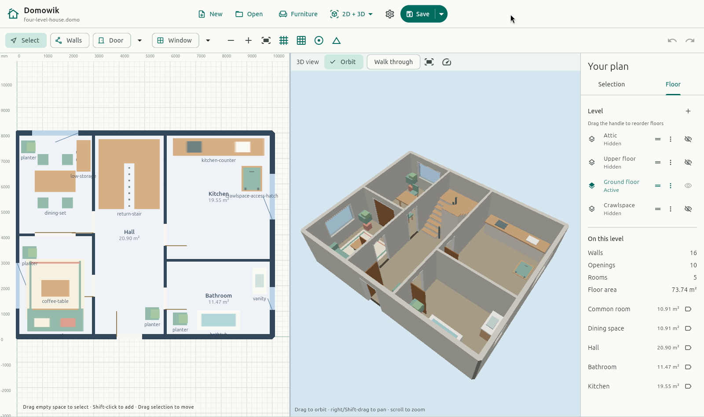
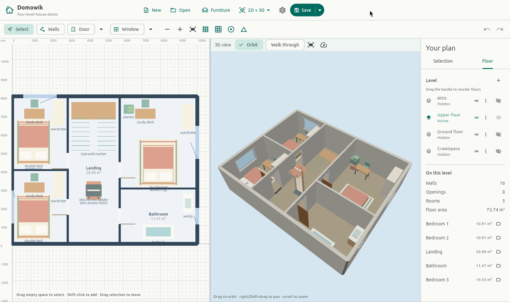
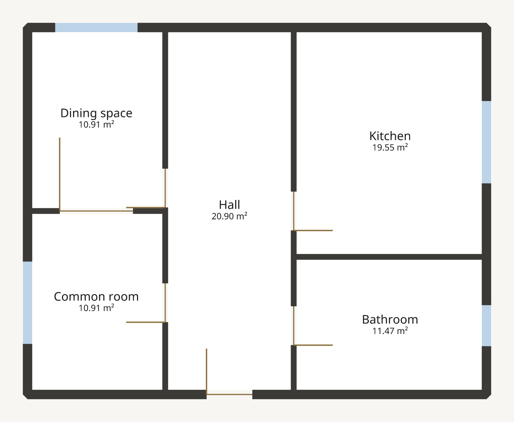
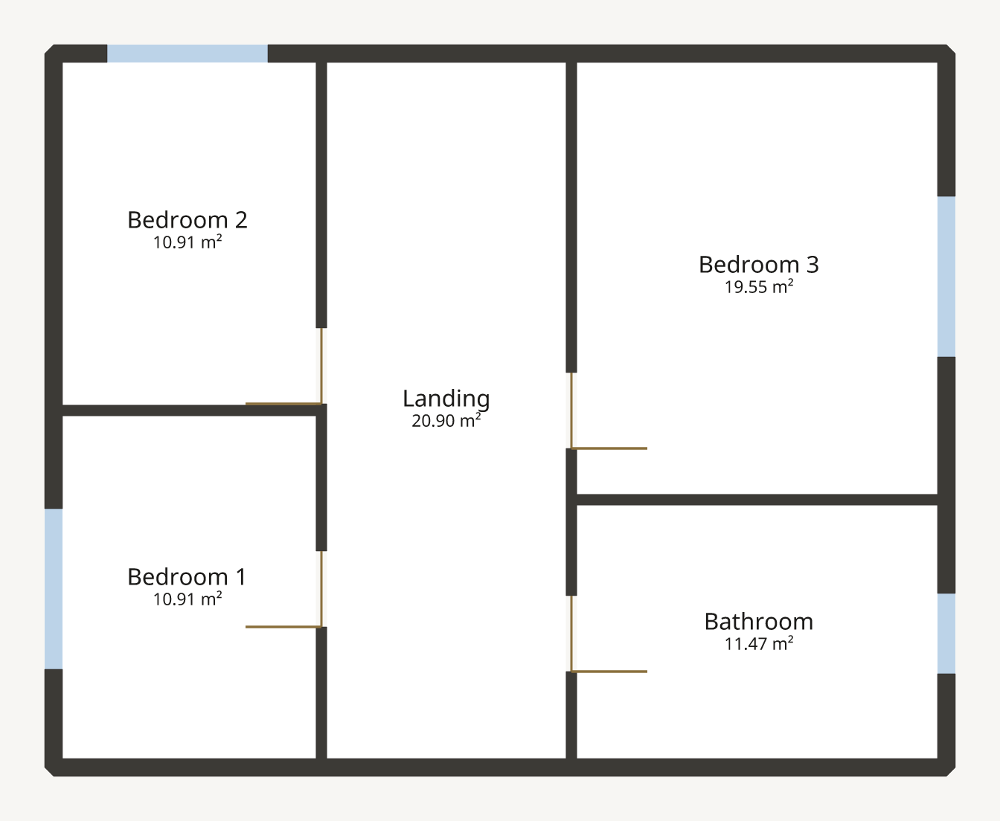
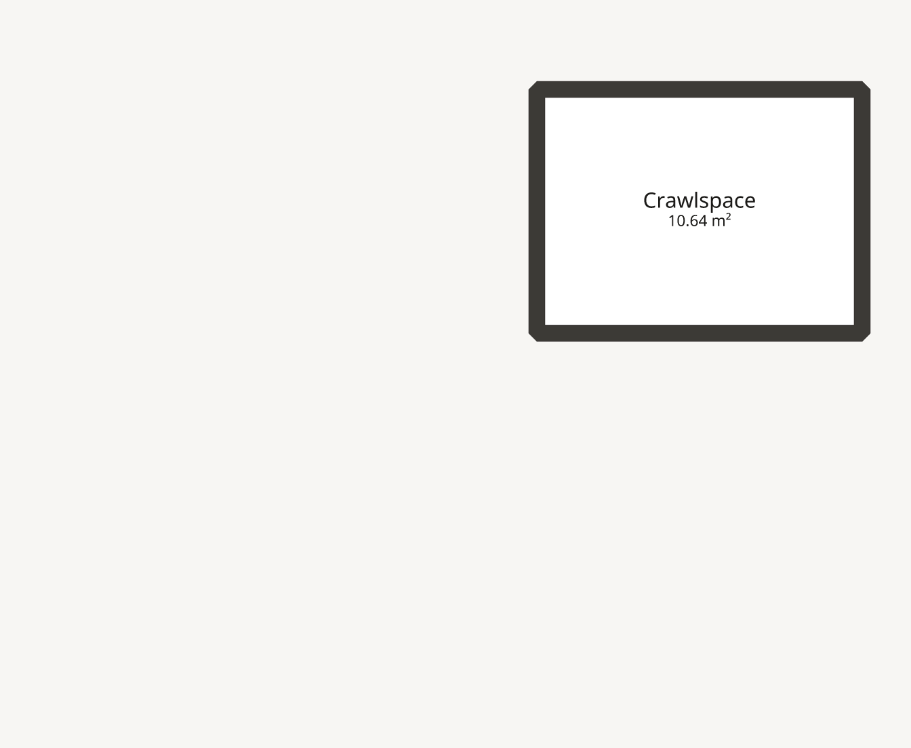
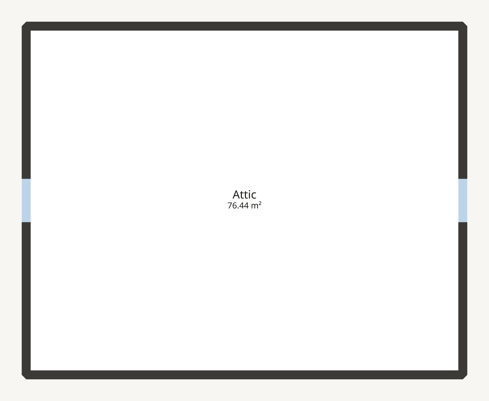

# Four-level house

An imaginary home with two living floors, a small crawlspace below ground
and an attic above. Use it to explore overlapping plans, level elevations
and different wall heights, with warm wood, sage seating, patterned rugs and
original mock furniture. All 17 models and 37 placed objects are embedded.

[Download the editable plan](four-level-house.domo?raw=true) ·
[Read the user guide](../../docs/USER-GUIDE.md)



## Open it

1. Download `four-level-house.domo`, or find it here in your checkout.
2. Run the [desktop or browser editor](../../docs/GETTING-STARTED.md), choose
   **Open**, then select the file.
3. In **Floor**, select **Ground floor**, then choose **Fit plan**. On narrow
   screens, the layers button opens **Levels and plan details**.
4. Switch between **Crawlspace**, **Ground floor**, **Upper floor** and
   **Attic**. Try **2D + 3D** to explore the stacked levels.
5. Save a copy under a new name before experimenting with walls or openings.

The floor list runs from attic to crawlspace. On a first open the editor
activates the lowest floor, so select Ground floor to start with the main
living spaces. No external assets or network access are needed.

## Decoration and access

- **Downstairs:** a sofa and coffee table on a bordered rug, a dining set,
  kitchen counter, bathtub and vanity, plants and a low dining-room cabinet.
- **Upstairs:** three furnished bedrooms, each with a bed, rug, wardrobe and
  study desk; the bathroom has a bathtub and vanity.
- **Attic:** three low storage cabinets, sized to fit the 1500 mm wall height.
- **Living-floor stair:** a compact return stair in the north end of the hall,
  with two flights and a shared landing. Its 2800 mm rise has sixteen
  illustrative 175 mm risers. A flat stairwell marker shows its footprint on
  the upper landing. The hall is 2800 mm between partition centre lines;
  nearby room doors sit south of the stair.
- **Crawlspace hatch:** a sage 800 × 1000 mm cover in the kitchen at
  (9200, 6200) mm. The matching ceiling-side cover appears in the crawlspace.
- **Attic hatch:** a coral 800 × 1000 mm cover above the upper landing at
  (4400, 2900) mm, with an upright access ladder below and a matching cover
  on the attic floor.

**The stair, ladder and hatches are illustrative imported models, not native
stair/opening entities. They do not cut holes in floors or ceilings.** Inspect
the ground floor with higher levels hidden to see the stair flights in 3D;
an upper slab can otherwise obscure them. They are not walk-through connections
or a verified access/egress design.

The eight new models in [models/](models/) are generated from coloured boxes
by [furnish.py](furnish.py), using the project's existing GLB box builder.
The other nine are reused from [Welcome Home](../welcome-home/README.md).
These are imaginary, unbranded objects, not a downloaded furniture catalog.



## Layout and assumed dimensions

All dimensions are invented, not owner measurements. The main footprint is
10 × 8 m **between outer wall centre lines**; exterior walls are 200 mm thick
and partitions are 120 mm. Room areas in the exports are measured to interior
wall faces, not those centre lines.

| Level | Elevation | Wall / ceiling height | Spaces |
| --- | --- | --- | --- |
| Attic | +5600 mm | 1500 mm | One open attic |
| Upper floor | +2800 mm | 2500 mm | Three bedrooms, bathroom and landing |
| Ground floor | 0 mm | 2500 mm | Common room, dining space, bathroom, kitchen and hall |
| Crawlspace | −1200 mm | 900 mm | One small void below the kitchen |

Each level has a 300 mm floor thickness extending below its elevation. The
crawlspace is only 4 × 3 m between wall centre lines, at x = 6000–10000 mm,
y = 4500–7500 mm; it does not extend beneath the whole house. Its wall tops
meet the underside of the ground-floor slab. The two living floors share
an aligned central hall/landing, with a door to every adjacent room.

### Ground floor

The common room and dining space occupy the west side and connect through
a wide sliding door. The kitchen and bathroom are on the east side. The
entrance opens into the central hall; each of the four main rooms has an
exterior window. The bathroom window has a higher sill.

The PNG/SVG exports below show the room layout only. Imported decoration,
stairs and hatches appear in the editor's 2D/3D views, not the CLI exports.



[Ground-floor SVG](ground-floor.svg)

### Upper floor

Two bedrooms sit on the west side; the third bedroom and bathroom are on
the east. All four open onto the landing and have exterior windows.



[Upper-floor SVG](upper-floor.svg)

### Crawlspace

The small, low space below the kitchen has no wall doors or windows. A
ceiling-side model marks the hatch above it. It is a service void, not an
extra bedroom or a full-height basement.



[Crawlspace SVG](crawlspace.svg)

### Attic

The attic spans the main footprint, with two low wall windows. It is drawn
schematically with vertical walls and a uniform height, **not a pitched roof**.



[Attic SVG](attic.svg)

## Simplifications

The stair, ladder and hatch models do not create slab openings, connectivity
or automatic headroom checks. The attic has no roof geometry or headroom
calculation. Furniture and fixtures are simplified mock objects, not a complete
appliance or services layout; toilets, terrain and structural details are
omitted. This is a level-editing example, not a construction design,
accessibility study or claim of building-code compliance.

## Regenerate and check

Requires Python 3, the pinned Rust toolchain and the compiled native frontend
bridge on Linux or macOS. No Python packages or external asset downloads:

```sh
# From the repository root:
cargo build --release --locked -p domowik-cli
(cd frontend && cargo build --release --locked -p domowik-frontend-bridge)
# Move your existing example aside first; the generator refuses to overwrite it.
python3 examples/four-level-house/generate.py
```

[The generator](generate.py) authors walls, openings and room names with CLI
commands, then imports and places models through the documented native C ABI.
It never edits the package ZIP or writes raw operation batches. Wall references
come from `info --json` UUIDs so identical coordinates on different levels are not
ambiguous. Geometry and exports are repeatable; plan IDs and timestamps are
new on each run.

It validates the file, runs strict drafting checks globally and on each
level, checks all twelve room names, level dimensions, wall heights and
door/window counts, verifies assets, then exports each floor to PNG and SVG.
Furniture/access model names, counts, levels, positions, elevations and rotations
are checked both before saving and after reopening the file.
To inspect the included file without regenerating it:

```sh
target/release/domowik validate examples/four-level-house/four-level-house.domo
target/release/domowik check examples/four-level-house/four-level-house.domo --strict
target/release/domowik info examples/four-level-house/four-level-house.domo --json
target/release/domowik export-png examples/four-level-house/four-level-house.domo \
  ground-review.png --level "Ground floor" --review
```

## Provenance

The layout, dimensions, generators, new models, plan and CLI exports are
original synthetic Domowik project content under the repository's
[Apache-2.0 licence](../../LICENSE).
The nine reused models and box builder are original Apache-2.0 Domowik content
from Welcome Home. No real owner's plan, third-party design, model, photograph
or texture was used. The floor exports are generated by Domowik; the two editor
screenshots show the actual Linux application in **2D + 3D** with only the active
level visible. Existing project notices for fonts and platform scaffolding still
apply. No dependencies or bundled third-party assets are added.
