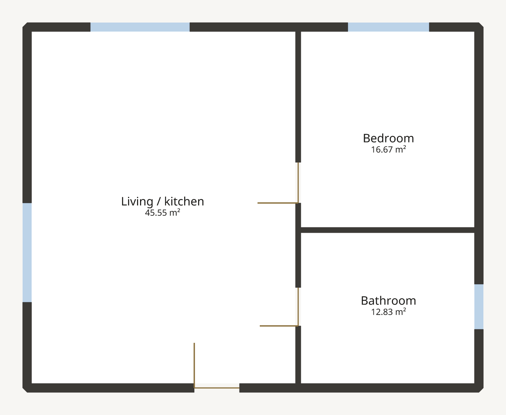

# Welcome Home

An imaginary 10 × 8 m single-storey home to explore and change in Domowik.
Open the living/kitchen area, bedroom and bathroom, then try moving the sage
sofa, resizing the dining set or moving a door. **Undo** lets you experiment.

[Download the editable plan](welcome-home.domo?raw=true) ·
[View the plan export](../../docs/images/welcome-home-plan.png)


## Open it

1. Download `welcome-home.domo`, or find it here in your checkout.
2. Run the [desktop or browser editor](../../docs/GETTING-STARTED.md).
3. Choose **Open**, select the file, then choose **2D + 3D**.
4. Choose **Fit plan** if needed. Use **Furniture** to see the embedded models.
5. Save a copy under a new name to keep the original example handy.

All nine models are embedded; no model directories, network access or asset
installation are needed. There are eleven placed objects because the planter
is reused. The dimensions are invented, not a survey or construction design.
The internal floor area is approximately 75.05 m², measured to inner wall faces.
The bathroom is deliberately simplified; the example does not claim building
code compliance or complete services/appliances.



This CLI export explains walls, openings and room areas. Imported furniture
previews appear in the editor; the current CLI export does not draw them.

## Original mock furniture

`models/` contains a sage sofa, coffee table, dining set, double bed, kitchen
counter, wardrobe, bathtub, vanity and planter. Each is a small GLB assembled
from coloured boxes by [generate.py](generate.py). They represent imaginary
objects, with no brand or catalog data. You can also import these individual
files through **Furniture → Upload model** in another plan.


The plan, models, generator and documentation images are original Domowik
project content under the repository's [Apache-2.0 licence](../../LICENSE).
No owner's plans, third-party models, photographs or textures are included.
Screenshots show Domowik's actual Linux editor; fonts and platform scaffolding
retain the upstream notices already recorded by the project. These example
models are repository examples, not an automatically installed furniture catalog.

## Regenerate

Requires Python 3, the pinned Rust toolchain and the compiled native bridge;
no Python packages or external asset downloads:

```sh
# From the repository root:
cargo build --release --locked -p domowik-cli
(cd frontend && cargo build --release --locked -p domowik-frontend-bridge)
# Move your existing demo aside first; the generator refuses to overwrite it.
python3 examples/welcome-home/generate.py
```

The generator authors walls, openings and room names through CLI commands,
then imports and places its own GLBs through the documented native C ABI.
It never edits the package ZIP or writes raw operation batches. Model bytes
are deterministic; plan IDs/timestamps are newly created on each run.
It validates the plan, verifies embedded asset digests and runs strict drafting
checks, then exports the PNG and SVG. To inspect the included file separately:

```sh
target/release/domowik validate examples/welcome-home/welcome-home.domo
target/release/domowik check examples/welcome-home/welcome-home.domo --strict
target/release/domowik asset verify examples/welcome-home/welcome-home.domo
```
